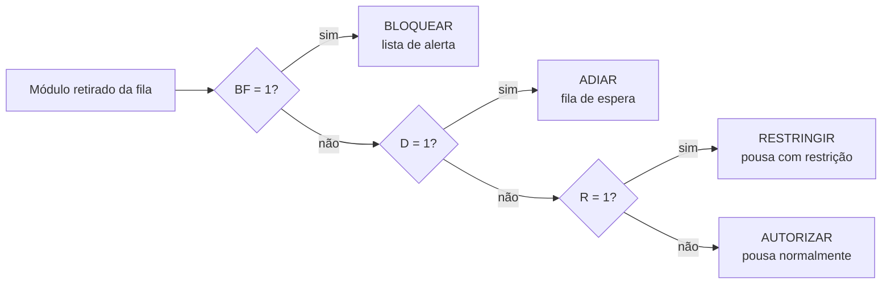
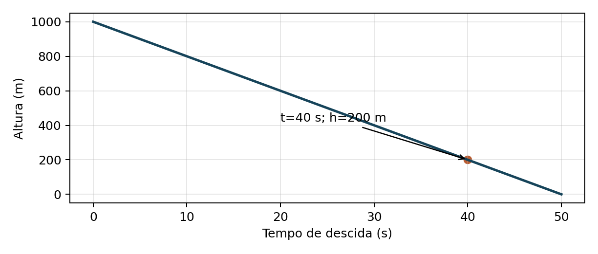
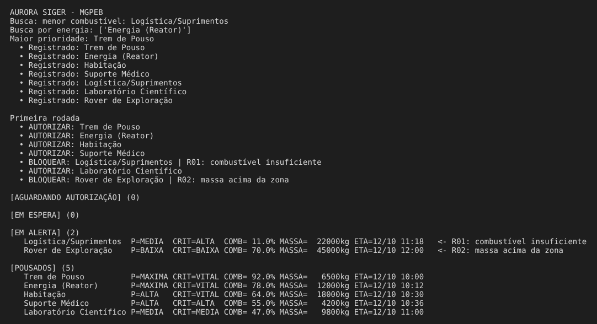
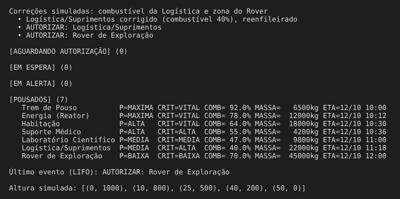

# 🪐 Missão Aurora Siger — Fase 2

## MGPEB · Módulo de Gerenciamento de Pouso e Estabilização de Base


Projeto desenvolvido para a **Fase 2 da FIAP** (Ciência da Computação). Depois da verificação de pré-decolagem da Fase 1, a nave Aurora Siger chega à órbita de Marte e precisa pousar os módulos que vão formar a base da colônia.

O **MGPEB** é um protótipo em Python que organiza esses módulos em estruturas de dados lineares, aplica regras de segurança modeladas com lógica booleana e decide, para cada módulo, se o pouso será **autorizado**, **restringido**, **adiado** ou **bloqueado**.

> Os valores de combustível, massa, vento, sensores e zonas de pouso são hipóteses didáticas definidas pelo grupo, sem validação para uma missão real.

---

## 🛰️ Cenário de pouso

A simulação começa em 12/10/2026, às 12h, com sete módulos em órbita.

| Módulo | Prioridade | Criticidade | Combustível | Massa | Depende de |
|---|---|---|---|---|---|
| Trem de Pouso | Máxima | Vital | 92% | 6,5 t | — |
| Energia (Reator) | Máxima | Vital | 78% | 12 t | Trem de Pouso |
| Habitação | Alta | Vital | 64% | 18 t | Energia |
| Suporte Médico | Alta | Alta | 55% | 4,2 t | Habitação |
| Laboratório Científico | Média | Média | 47% | 9,8 t | Energia |
| Logística/Suprimentos | Média | Alta | 11% | 22 t | — |
| Rover de Exploração | Baixa | Baixa | 70% | 45 t | — |

Há duas zonas de pouso: **ZP-1** (até 40.000 kg) e **ZP-2** (até 50.000 kg).

---

## 🧠 Regras de decisão

São 14 regras e uma meta-regra. Cada uma é uma condição booleana que vale 1 quando é violada.

| Grupo | Regras | Exemplos |
|---|---|---|
| **Bloquear** | R01 a R05 | combustível abaixo do mínimo, massa acima da zona, sensor crítico degradado |
| **Adiar** | R06 a R11 | vento forte, tempestade de poeira, dependência ainda não pousada |
| **Restringir** | R12 a R14 | margem de combustível baixa, navegação degradada |
| **Meta-regra M01** | adiamento **AND** margem < 3 pontos | sem combustível para esperar em órbita → bloqueia |

O combustível mínimo depende da massa: **Fmin = 12 + 0,5 × (massa em toneladas)**, em %.

### Expressões booleanas

```
B  = R01 OR R02 OR R03 OR R04 OR R05
D  = R06 OR R07 OR R08 OR R09 OR R10 OR R11
R  = R12 OR R13 OR R14
BF = B OR (D AND margem < 3)

BLOQUEAR   = BF
ADIAR      = NOT BF AND D
RESTRINGIR = NOT BF AND NOT D AND R
AUTORIZAR  = NOT BF AND NOT D AND NOT R
```

As quatro saídas são mutuamente exclusivas. A precedência é **BLOQUEAR > ADIAR > RESTRINGIR > AUTORIZAR**.



Os diagramas completos de portas lógicas estão no [relatório técnico](docs/Relatorio_MGPEB.pdf), e a descrição detalhada de cada regra está no documento de [regras de decisão](docs/Regras_de_Decisao_Pouso_Marte.docx).

---

## 🗂️ Estruturas de dados

Todas as estruturas foram implementadas manualmente com nós encadeados (classe `Nodo`), sem usar `list` do Python como estrutura principal.

| Estrutura | Classe | Uso no MGPEB |
|---|---|---|
| Fila de prioridade | `FilaPrioridade` | Módulos aguardando autorização, ordenados por (prioridade, −criticidade, ETA) |
| Fila FIFO | `Fila` | Módulos adiados, reavaliados quando o cenário muda |
| Lista encadeada | `ListaEncadeada` | Módulos pousados e módulos em alerta |
| Pilha LIFO | `Pilha` | Histórico de eventos do controle de missão (o mais recente fica no topo) |

## 🔎 Busca e ordenação

- **Busca sequencial** (`busca_sequencial`, `menor_combustivel`): percorre os módulos uma vez — **O(n)**.
- **Ordenação por inserção** (`ordenar_insercao`): reorganiza a fila de pouso — **O(n²)** no pior caso, **O(n)** se já estiver ordenada. É estável: módulos com a mesma chave mantêm a ordem original.

---

## 📉 Modelagem matemática

Altura do módulo em função do tempo, numa etapa simplificada de descida controlada:

**h(t) = 1000 − 20t**, com h em metros, t em segundos e 0 ≤ t ≤ 50.

- 1000 é a altura inicial;
- −20 é a taxa de descida (20 m/s).



A altura chega a 200 m em t = 40 s, o que permite planejar uma verificação de frenagem antes do contato com o solo. Se a taxa subir para 25 m/s, o tempo até o solo cai para 40 s e a janela de reação diminui.

---

## 🛠️ Tecnologias utilizadas

- Python 3 (apenas biblioteca padrão: `dataclasses`, `datetime`, `enum`)
- Visual Studio Code
- GitHub

---

## ▶️ Como executar

Não é necessário instalar nenhum pacote.

1. Faça o download ou clone deste repositório.
2. Entre na pasta da Fase 2:

```bash
cd fase-2-mgpeb
```

3. Execute o protótipo:

```bash
py MGPEB.py
```

No Linux ou macOS, use `python3 MGPEB.py`.

O programa roda uma demonstração completa: buscas, ordenação, primeira rodada de autorizações, correções simuladas, rodada final e a função de altura. A saída completa está em [`execucao_MGPEB.txt`](execucao_MGPEB.txt).

---

## 📊 Resultado da simulação

| Etapa | Resultado |
|---|---|
| Primeira rodada | 5 módulos pousados; Logística bloqueada por **R01** (11% < 23%) e Rover bloqueado por **R02** (45 t > 40 t na ZP-1) |
| Correções simuladas | Logística reabastecida para 40%; Rover transferido para a ZP-2 |
| Rodada final | **7 módulos pousados**; filas de autorização, espera e alerta vazias |

---

## 📸 Evidências de execução

### Primeira rodada



### Correções e resultado final



---

## 📁 Arquivos desta pasta

| Arquivo | Descrição |
|---|---|
| `MGPEB.py` | Protótipo final, com as 14 regras e a meta-regra |
| `pouso_marte.py` | Primeira versão do protótipo, com apenas as regras de combustível e massa |
| `execucao_MGPEB.txt` | Saída completa da execução do `MGPEB.py` |
| `docs/Relatorio_MGPEB.pdf` | Relatório técnico entregue (portas lógicas, função, evolução da computação, ESG e anexo de estruturas) |
| `docs/Regras_de_Decisao_Pouso_Marte.docx` | Documento de especificação das regras de decisão |
| `img/` | Capa, gráfico e prints da execução |

---

## 👥 Integrantes — Grupo 37

- **Enzo Yugi Kloiwa** — RM 574398
- **Guilherme de Souza Santos** — RM 574908
- **Luke Malaquias Lage** — RM 574356
- **Rafaela Aparecida dos Santos Atanásio** — RM 574868
- **Yasmin Sampaio Barbieri** — RM 576282

---

## 📚 Sobre o projeto

Este projeto possui finalidade exclusivamente acadêmica e foi desenvolvido como parte da Fase 2 da FIAP.
