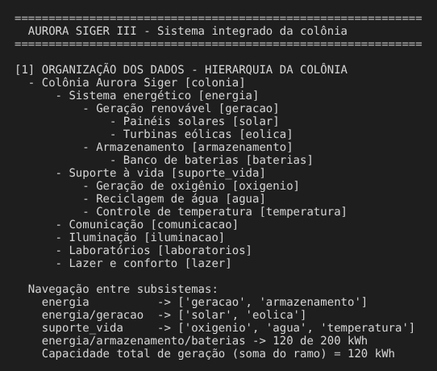
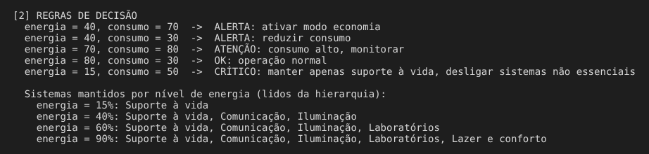
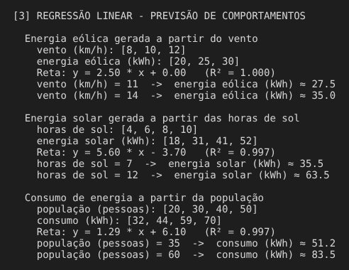
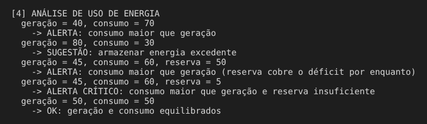
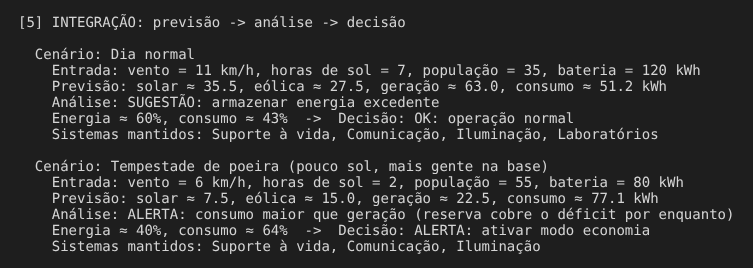

# 🏕️ Missão Aurora Siger — Fase 3

## Sistema integrado da colônia: dados, decisões e previsão

Projeto desenvolvido para a **Fase 3 da FIAP** (Ciência da Computação). Depois do pouso em Marte (Fase 2), a Aurora Siger estabelece os primeiros sistemas da colônia.

Este sistema em Python representa o funcionamento inteligente da colônia:

1. **Organiza os dados** da colônia em uma hierarquia de sistemas, em tabelas chave-valor e em listas;
2. **Toma decisões automaticamente** com regras simples, combinadas e com prioridade;
3. **Prevê comportamentos** com regressão linear: vento → energia eólica, horas de sol → energia solar, população → consumo;
4. **Analisa o uso de energia**, comparando geração, consumo e reserva;
5. **Integra tudo** num único fluxo: previsão → análise → decisão.

> Os valores e limites utilizados são premissas acadêmicas definidas pelo grupo para fins de simulação.

---

## ⚙️ Como funciona

```
 DADOS (dados.py)            LÓGICA                         DECISÃO (decisoes.py)
 ┌──────────────────┐   ┌──────────────────────────┐   ┌───────────────────────────┐
 │ hierarquia       │──▶│ navegação (estrutura.py) │──▶│ regras de decisão         │
 │ clima e cenários │──▶│ regressão (previsao.py)  │──▶│ análise de energia        │──▶ "ALERTA: ..."
 │ histórico        │   └──────────────────────────┘   │ sistemas que ficam ligados│
 └──────────────────┘                                  └───────────────────────────┘
```

| Arquivo | Papel | O que tem |
|---|---|---|
| `dados.py` | **Dados** | Hierarquia da colônia, cenários (clima, população, bateria) e histórico para a regressão |
| `estrutura.py` | **Lógica** | Navegação na hierarquia: `navegar`, `listar_subsistemas`, `mostrar_arvore`, `somar_campo` |
| `previsao.py` | **Lógica** | Regressão linear pelos mínimos quadrados: `ajustar_reta`, `prever`, `calcular_r2` |
| `decisoes.py` | **Decisões** | `decidir_acao`, `sistemas_a_manter`, `analisar_energia` |
| `main.py` | **Integração** | `simular_cenario` (previsão → análise → decisão), demonstração e modo interativo |
| `validar_sistema.py` | Testes | 25 testes automatizados |

---

## 🗂️ 1. Organização dos dados

### Hierarquia (árvore de dicionários)

```
Colônia Aurora Siger
├── Sistema energético
│   ├── Geração renovável
│   │   ├── Painéis solares    (capacidade 70 kWh)
│   │   └── Turbinas eólicas   (capacidade 50 kWh)
│   └── Armazenamento
│       └── Banco de baterias  (120 de 200 kWh)
├── Suporte à vida             (prioridade 1, nunca desliga)
│   ├── Geração de oxigênio
│   ├── Reciclagem de água
│   └── Controle de temperatura
├── Comunicação                (prioridade 2, desliga abaixo de 20%)
├── Iluminação                 (prioridade 3, desliga abaixo de 35%)
├── Laboratórios               (prioridade 4, desliga abaixo de 50%)
└── Lazer e conforto           (prioridade 5, desliga abaixo de 70%)
```

A navegação entre subsistemas usa caminhos:

```python
navegar(COLONIA, "energia/geracao")        # nó "Geração renovável"
listar_subsistemas(...)                    # ['solar', 'eolica']
somar_campo(..., "capacidade_kwh")         # 120 (soma recursiva do ramo)
```

### Chave-valor e listas

- **Cenários** (`CENARIOS`): clima (`vento_kmh`, `horas_sol`), população e carga da bateria, acessados por nome.
- **Histórico** (`HISTORICO`): listas de observações. Por exemplo, `vento = [8, 10, 12]` e `energia = [20, 25, 30]`.

---

## 🧠 2. Regras de decisão

Entradas: **energia (%)** e **consumo (%)**. A primeira regra verdadeira vence:

| Prioridade | Condição | Saída |
|---|---|---|
| 1 | energia < 20 | `CRÍTICO: manter apenas suporte à vida, desligar sistemas não essenciais` |
| 2 | energia < 50 **E** consumo > 60 | `ALERTA: ativar modo economia` |
| 3 | energia < 50 | `ALERTA: reduzir consumo` |
| 4 | consumo > 60 | `ATENÇÃO: consumo alto, monitorar` |
| 5 | caso contrário | `OK: operação normal` |

A função `sistemas_a_manter` percorre a hierarquia por prioridade e mantém ligados só os sistemas cuja energia mínima é atendida. O suporte à vida nunca é desligado.

---

## 📈 3. Previsão com regressão linear

Para cada comportamento, o sistema ajusta uma reta **y = a·x + b** aos dados históricos (mínimos quadrados) e usa a reta para estimar valores novos. O **R²** indica o quanto a reta explica os dados: quanto mais perto de 1, mais confiável a previsão.

| Comportamento | Reta ajustada | R² |
|---|---|---|
| Vento (km/h) → energia eólica (kWh) | y = 2,50x + 0,00 | 1,000 |
| Horas de sol → energia solar (kWh) | y = 5,60x − 3,70 | 0,997 |
| População → consumo (kWh) | y = 1,29x + 6,10 | 0,997 |

---

## ⚡ 4. Análise do uso de energia

| Situação | Saída |
|---|---|
| consumo > geração, sem reserva informada | `ALERTA: consumo maior que geração` |
| consumo > geração, reserva cobre o déficit | `ALERTA: consumo maior que geração (reserva cobre o déficit por enquanto)` |
| consumo > geração, reserva não cobre | `ALERTA CRÍTICO: consumo maior que geração e reserva insuficiente` |
| geração > consumo | `SUGESTÃO: armazenar energia excedente` |
| geração = consumo | `OK: geração e consumo equilibrados` |

---

## 🔁 5. Integração: previsão → análise → decisão

A função `simular_cenario` faz o fluxo completo:

1. Prevê a geração solar e eólica a partir do clima, limitada à capacidade instalada, e o consumo a partir da população;
2. Grava as previsões nos nós da hierarquia e soma o ramo de geração;
3. Compara geração, consumo e reserva das baterias;
4. Calcula a **energia (%)**, que é a carga da bateria sobre a capacidade da bateria, e o **consumo (%)**, que é o consumo previsto sobre a capacidade de geração;
5. Decide a ação e quais sistemas ficam ligados.

---

## 📥📤 Exemplos de entrada e saída

| Entrada | Saída |
|---|---|
| energia = 40, consumo = 70 | `ALERTA: ativar modo economia` |
| energia = 40, consumo = 30 | `ALERTA: reduzir consumo` |
| energia = 15, consumo = 50 | `CRÍTICO: manter apenas suporte à vida, desligar sistemas não essenciais` |
| vento = 11 km/h | previsão de energia eólica ≈ **27,5 kWh** |
| geração = 40, consumo = 70 | `ALERTA: consumo maior que geração` |
| geração = 80, consumo = 30 | `SUGESTÃO: armazenar energia excedente` |

### Cenários integrados

| Cenário | Entrada | Previsão | Análise | Decisão |
|---|---|---|---|---|
| Dia normal | vento 11, sol 7 h, 35 pessoas, bateria 120 kWh | geração ≈ 63,0 · consumo ≈ 51,2 kWh | armazenar excedente | `OK: operação normal` (energia 60%, consumo 43%) |
| Tempestade de poeira | vento 6, sol 2 h, 55 pessoas, bateria 80 kWh | geração ≈ 22,5 · consumo ≈ 77,1 kWh | déficit coberto pela reserva | `ALERTA: ativar modo economia` (energia 40%, consumo 64%); Laboratórios e Lazer desligados |

---

## ▶️ Como executar

Não é necessário instalar nenhum pacote. Basta ter o Python 3.

```bash
cd fase-3-sistemas-colonia
py main.py
```

No Linux ou macOS, use `python3 main.py`. A saída completa está em [`execucao.txt`](execucao.txt).

### Modo interativo

```bash
py main.py --interativo
```

Depois da demonstração, um menu permite digitar seus próprios valores:

```
--- MODO INTERATIVO ---
  1) Prever geração ou consumo (regressão)
  2) Decidir ação (energia % e consumo %)
  3) Analisar energia (geração, consumo e reserva)
  4) Navegar na hierarquia da colônia
  0) Sair
Opção: 2
  Energia (%): 40
  Consumo (%): 70
  -> ALERTA: ativar modo economia
  Sistemas mantidos: Suporte à vida, Comunicação, Iluminação
```

### Testes

```bash
py validar_sistema.py
```

São 25 testes (`unittest`, biblioteca padrão) que cobrem a navegação na hierarquia, as regras e seus limites, os exemplos do enunciado, a regressão e os dois cenários integrados.

---

## 📸 Evidências de execução

### Hierarquia e navegação



### Regras de decisão



### Regressão linear



### Análise de energia



### Integração



---

## 🛠️ Tecnologias utilizadas

- Python 3 (apenas biblioteca padrão: `copy`, `sys`, `unittest`)
- Visual Studio Code
- GitHub

---

## 👥 Integrantes — Grupo 37

- **Enzo Yugi Kloiwa** — RM 574398
- **Guilherme de Souza Santos** — RM 574908
- **Luke Malaquias Lage** — RM 574356
- **Rafaela Aparecida dos Santos Atanásio** — RM 574868
- **Yasmin Sampaio Barbieri** — RM 576282

---

## 📚 Sobre o projeto

Este projeto possui finalidade exclusivamente acadêmica e foi desenvolvido como parte da Fase 3 da FIAP.
